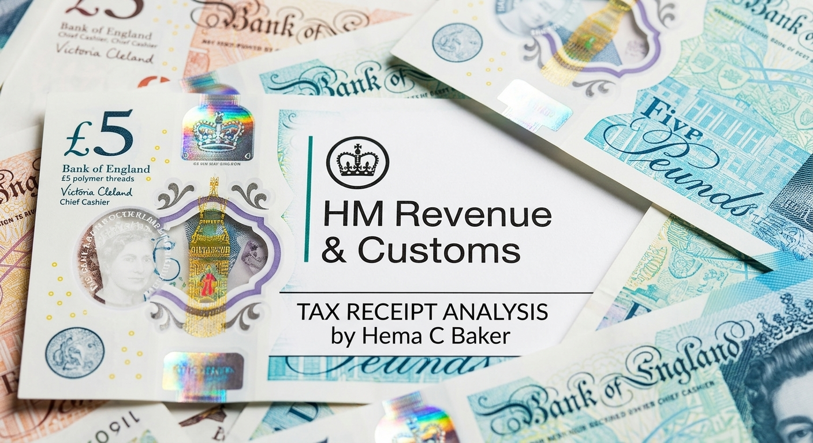
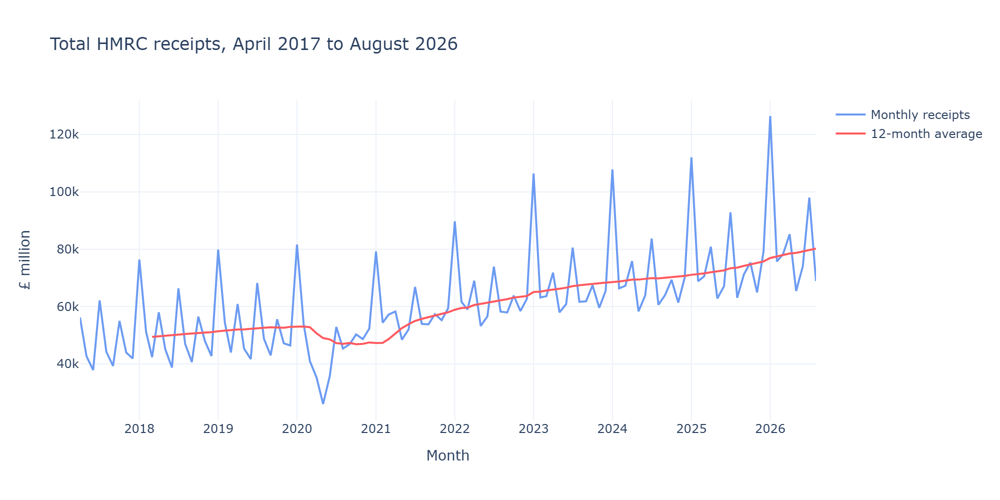
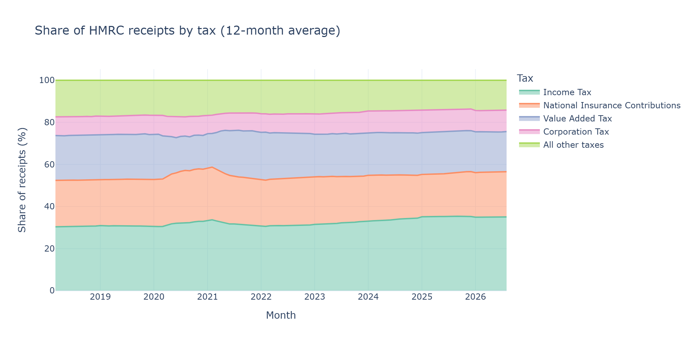
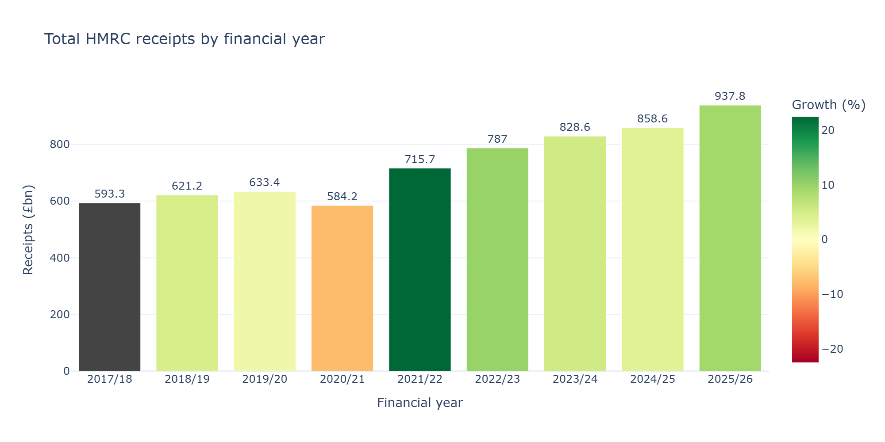
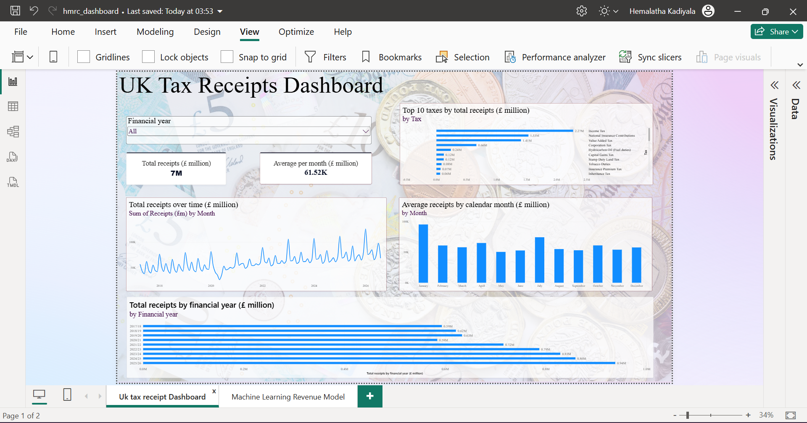
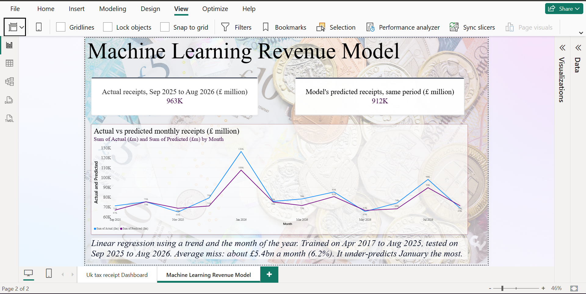

# 💷 HMRC Tax Receipts Analysis



Analysing UK tax and National Insurance receipts to spot patterns, test ideas and predict future receipts, with an interactive Power BI dashboard.

## 🎯 Purpose

HMRC publishes how much tax the UK collects every month. This project turns those numbers into clear answers in which taxes bring in the most money, when the money arrives, how receipts have changed since 2017, and whether next month's receipts can be predicted.

## 👥 Target audience

- 🏛️ Policy and finance teams who need to understand tax trends and plan around them.
- 📊 Analysts who want a clean, repeatable analysis they can rerun on new HMRC data.

## ❓ Business questions

1. 💷 Which taxes bring in the most money?
2. 📅 Do receipts follow a seasonal pattern, and when does each tax arrive?
3. 📈 How have receipts changed since 2017?
4. 🔗 Do some taxes move together?
5. 🔮 Can we predict future monthly receipts?

## 📥 Dataset

- **Source:** [HMRC tax and NICs receipts for the UK (monthly bulletin)](https://www.gov.uk/government/statistics/hmrc-tax-and-nics-receipts-for-the-uk/hmrc-tax-receipts-and-national-insurance-contributions-for-the-uk-new-monthly-bulletin), published on GOV.UK
- **Period:** April 2017 to August 2026 (113 months)
- **Content:** monthly receipts across 46 columns (individual taxes, their components and totals), in £ million, on a cash basis
- **Data notes:**
  - `[X]` in the file means "not available". Many newer taxes (for example the Digital Services Tax) are mostly empty
  - The latest months are provisional and may be revised
  - Figures are not adjusted for inflation
- The original spreadsheet was saved as `hmrc_monthly_receipts.csv` and is kept untouched in `data/raw`

## 🛠️ Tools

Python 3.12 · pandas · NumPy · SciPy · scikit-learn · matplotlib · seaborn · Plotly · Jupyter · Power BI Desktop · Git and GitHub

---

## 🧭 Project plan and process

The project followed a structured plan, one stage at a time:

```
1. Plan      → Kanban board with user stories and MoSCoW priorities
2. Extract   → load the raw HMRC file
3. Transform → clean it (notebook 01)
4. Explore   → charts and summary statistics (notebook 02)
5. Test      → statistics and hypotheses (notebook 03)
6. Predict   → machine learning model (notebook 04)
7. Share     → interactive Power BI dashboard
8. Conclude  → findings, recommendations and reflection
```

### 🧱 Project management

Work was planned and tracked on a GitHub Kanban board, with a user story for every piece of work and a MoSCoW priority (Must, Should, Could, Won't) on each one.

👉 [View the project board](https://github.com/users/hemacbaker-byte/projects/6)

- **Must-have stories** cover the pass requirements: repo set-up, README, loading and cleaning the data, exploration, charts, statistics, hypotheses, the machine learning model, the dashboard, conclusions, reflection and commenting the code
- **Should-have stories** added interactive filters, a predictions section and documentation of data limits
- **Could-have and Won't-have ideas** were moved to a **Features** column on the board as future work (see "Future features" below)
- Most commit messages name the user story they belong to (for example `US9: ...`), and `closes #9` closes the matching card on the board

### 📋 Where to find the evidence for each assessment criterion

- **LO1 Statistics and probability**
  - 1.1 Key principles: "Key concepts" in [03_statistics.ipynb](notebooks/03_statistics.ipynb) (mean, median, standard deviation, probability, hypothesis testing, correlation)
  - 1.2 Applied with examples: the t-test, the correlation tests and the probability counts in notebook 03
  - 1.3 Machine learning: linear regression with an actual vs predicted chart in [04_machine_learning.ipynb](notebooks/04_machine_learning.ipynb)
- **LO2 Structure and plan**
  - 2.1 Organised project: the folder structure, ETL pipeline and commit history below
  - 2.2 Justified methodology: "Why linear regression?" and "Alternatives considered" in notebook 04
- **LO3 Real-world analysis**
  - 3.1 Appropriate methods: cleaning, exploration and hypothesis tests in notebooks 01 to 03
  - 3.2 Effectiveness: "Evaluating the model" and the evaluation summary in notebook 04
  - 3.3 Structured plan: this README and the introduction and summary sections in each notebook
- **LO4 Tools**
  - 4.1 Analytics tools: Python for the pipeline and Power BI for the dashboard (see "Interactive dashboard")
  - 4.2 Learning process: "Learning reflection" below

---

## 🗂️ Project structure

```
hmrc-tax-analysis/
├── data/
│   ├── raw/          original HMRC file (never edited)
│   └── processed/    cleaned data and files prepared for Power BI
├── notebooks/
│   ├── 01_etl.ipynb               load and clean the data
│   ├── 02_eda.ipynb               explore the data and chart it
│   ├── 03_statistics.ipynb        statistics and hypothesis tests
│   └── 04_machine_learning.ipynb  predict monthly receipts
├── dashboards/       Power BI dashboard (.pbix)
├── docs/             banner and dashboard screenshots
├── outputs/          saved charts (pictures and interactive versions)
├── requirements.txt  Python packages
└── README.md
```

## ▶️ How to run it

```
git clone https://github.com/hemacbaker-byte/hmrc-tax-analysis.git
cd hmrc-tax-analysis
python -m venv .venv
.venv\Scripts\activate
pip install -r requirements.txt
```

Then open the notebooks in VS Code (choose the `.venv` kernel) and run them in order, 01 to 04. Each notebook starts from the cleaned file saved by the one before it. Notebook 02 saves its Plotly charts as pictures using `kaleido`, which needs Google Chrome installed. To open the dashboard, use Power BI Desktop and open `dashboards/hmrc_dashboard.pbix`.

---

## 🧹 Data preparation (ETL)

📓 [01_etl.ipynb](notebooks/01_etl.ipynb)

The raw file needed tidying before analysis:

- 🔚 Removed a footer row that was a note, not a month
- 🔢 Converted numbers stored as text (with commas) into real numbers
- ❌ Turned `[X]` (not available) into proper empty values
- 📅 Converted months such as "April 2017" into real dates
- 🗑️ Dropped two columns (Bank payroll tax and Misc) that were empty in every month

**Result:** 113 months by 45 columns, saved as `data/processed/hmrc_clean.csv`.

## 🔍 Exploration and key findings

📓 [02_eda.ipynb](notebooks/02_eda.ipynb)

- 💷 **Income Tax is the biggest tax**, averaging about £20.1bn a month, followed by National Insurance (£13.5bn), VAT (£12.4bn) and Corporation Tax (£5.9bn). Together these four make up about 85% of everything collected
- 📅 **January is the busiest month**, about 54% above a typical month. May is the quietest, about 15% below
- 🗓️ **Each tax has its own rhythm.** VAT peaks every quarter (January, April, July, October), Corporation Tax peaks in March, June, September and December, and Capital Gains Tax arrives almost entirely in January
- 📈 **Receipts grew** from about £593bn in 2017/18 to about £938bn in 2025/26
- 🦠 **The Covid year (2020/21) saw a 7.8% fall**, followed by a 22.5% rebound the year after
- 🔗 **Income Tax and National Insurance move closely together** (correlation 0.82)
- 🥧 **Income Tax is carrying more of the load**: its share of receipts rose from about 30% to about 35%

### 📊 Charts





---

## 🔬 Statistics and hypotheses

📓 [03_statistics.ipynb](notebooks/03_statistics.ipynb)

The notebook explains mean, median, standard deviation, probability, hypothesis testing and correlation in plain words, and shows each one on the HMRC data. For example, total receipts average about £61.5bn a month with a standard deviation of about £16.7bn, and only 3.5% of months (4 out of 113, all of them Januaries) topped £100bn.

### 📅 Hypothesis 1: the January effect
- **Null hypothesis (H0):** average receipts in January are the same as in other months
- **Alternative hypothesis (H1):** average receipts in January are higher
- **Test:** Welch's t-test, significance level 0.05
- **Result:** January averaged about £95.5bn against about £58.6bn for other months (t = 6.01, p about 0.0001). ✅ **H0 rejected**
- **Check without the trend:** using a seasonal index, January scored 1.55 against 0.95 (p far below 0.001), so the effect is real and not just a rising trend

### 🔗 Hypothesis 2: Income Tax and National Insurance
- **Null hypothesis (H0):** there is no positive correlation between the two
- **Alternative hypothesis (H1):** they are positively correlated
- **Test:** Pearson correlation, significance level 0.05
- **Result:** r = 0.82 across 113 months (p far below 0.001). ✅ **H0 rejected**
- **Check without the trend:** comparing yearly growth rates gives r = 0.38 (p below 0.001), so the link is real but moderate once the shared upward trend is removed

---

## 🤖 Machine learning

📓 [04_machine_learning.ipynb](notebooks/04_machine_learning.ipynb)

**Problem:** predict total monthly HMRC receipts.

**Model:** linear regression, using two clues: a time counter (the upward trend) and the month of the year (January is high, May is low).

**Why this model:** it matches what the exploration and statistics found (a steady trend plus a proven seasonal pattern), it works well on a small dataset of 113 months, it can be explained to a finance team, and it can keep following a rising trend.

**Alternatives considered:**
- Random forest: handles uneven patterns but cannot predict above the highest value it has seen, and could memorise a small dataset
- Time-series models such as SARIMA: designed for this kind of data, but harder to explain and beyond the chosen toolset
- Neural networks: need far more data than 113 months

**Testing:** trained on April 2017 to August 2025 (101 months), then tested on the last 12 months (September 2025 to August 2026), which the model had never seen. The split is by time, not random, so the model never peeks at the future.

**Results:**
- Average miss of about **£5.4bn a month (6.2%)**, and it captures about 80% of the ups and downs in monthly receipts (R-squared 0.80)
- It beats the simple baseline "same month last year" (about £6.6bn, 8.1%), and was closer in 8 of the 12 months
- Over the 12 months it predicted about £912bn against an actual £963bn (about 5% too low)

**Weaknesses:**
- It under-predicted in 9 of the 12 months, because receipts grew faster recently than the trend it learned
- It struggles most with January: in January 2026 it predicted about £107.5bn against an actual £126.4bn (about 15% too low)
- The Covid dip sits inside the training data and does not fit a straight trend neatly

---

## 🎛️ Interactive dashboard

📁 [`dashboards/hmrc_dashboard.pbix`](dashboards/hmrc_dashboard.pbix) (open with Power BI Desktop)

The dashboard has two pages. Python prepares the data for it (notebook 04, Part 5), and Power BI turns it into an interactive report.

### Page 1: UK Tax Receipts Dashboard


- A **Financial year** filter changes the cards and charts together
- Two cards: total receipts and average receipts per month
- Charts: the top 10 taxes, receipts over time, average receipts by calendar month, and total receipts by financial year

### Page 2: Machine Learning Revenue Model


Shows the model's predictions against what really happened over the last 12 months, with a short note on how the model was built and tested.

### 💬 Questions and answers the dashboard answers

**Q1: Which taxes bring in the most money?**
Income Tax is the biggest, at about 33% of all receipts. Income Tax, National Insurance, VAT and Corporation Tax together make up about 85%. Fuel duties come fifth.

**Q2: How have receipts changed over time?**
Receipts rise steadily from 2017, drop sharply in 2020 (the Covid period, lowest month about £26.0bn), then climb again and peak in January 2026 at about £126.4bn.

**Q3: Is there a seasonal pattern?**
Yes. January is by far the highest month, averaging about £95.5bn. July is second (about £74.5bn) and April third (about £65.1bn). May is the lowest at about £50.5bn.

**Q4: How much is collected overall?**
About £6.95 trillion between April 2017 and August 2026, an average of about £61.5bn a month.

**Q5: Can we predict future receipts?**
Reasonably well. Over the last 12 months the model predicted about £912bn against an actual £963bn, about 5% too low, and it follows the yearly pattern closely.

**Q6: Where does the model struggle?**
January 2026: it predicted about £107.5bn, but the actual figure was about £126.4bn. It tends to under-predict because receipts grew faster recently than the trend it learned.

**Q7: How reliable is it?**
On average it misses by about £5.4bn a month (6.2%), which beats the simple guess of "same month last year" (8.1%).

**Q8: How fast are receipts growing each year?**
Total receipts grew from about £593bn in 2017/18 to about £938bn in 2025/26. 2020/21 is the only year they fell (down 7.8%), followed by a strong rebound of 22.5% in 2021/22. Since then they have grown every year, between 3.6% and 10.0%.

### 🧩 Data model
- `hmrc_long`: one row per month per tax, with a **Row type** column (Tax, Component or Total). Totals and components are labelled because they already include other taxes, so the dashboard only adds up rows where Row type is Tax, or uses Total HMRC Receipts on its own, to avoid counting money twice
- `model_predictions`: 12 rows (actual and predicted receipts for the test months)
- The two tables are deliberately not linked, because the predictions cover a different, shorter period

### 🎨 Design choices
- Every chart title says what it shows and the unit (£ million)
- One filter, one font family and a consistent colour scheme keep the pages simple to use
- The financial year chart leaves out 2026/27, because it only has five months so far and would look like a fall in receipts
- Values are in £ million, so "7M" on a card means about £7 trillion across all 113 months

---

## ✅ Conclusions and recommendations

**Conclusions**
- Four taxes (Income Tax, National Insurance, VAT and Corporation Tax) bring in about 85% of what HMRC collects, and Income Tax is the biggest by a clear margin
- Receipts follow a strong, statistically proven yearly pattern, led by a very large January, and quarterly waves for VAT and Corporation Tax
- Receipts have grown strongly since 2017, apart from the Covid dip. These figures are not adjusted for inflation, so part of the rise is higher prices
- A simple model using a trend and the month of the year predicts monthly receipts to within about 6% on average and beats the obvious guess, but it is weakest in January

**Recommendations**
1. 📅 **Plan around the peaks.** Expect a very large inflow every January, VAT peaks in January, April, July and October, and Corporation Tax peaks in March, June, September and December
2. 🤖 **Use the model for rough monthly planning only**, and add a safety margin for January, where it missed by about 15% in 2026
3. 🔗 **Forecast Income Tax and National Insurance together**, but do not rely on one to predict the other, because the link is moderate once the shared trend is removed
4. 🔧 **Improve the model next** by adding the previous year's value for the same month, training on the post-Covid period, and adjusting for inflation

## ⚠️ Limitations

- The latest months are provisional and may be revised
- Figures are not adjusted for inflation
- Only nine Januaries are in the data, and monthly receipts are not fully independent of each other, so the p-values are best read as indicative
- Correlation does not show that one tax causes another
- The machine learning test covers only 12 months, so the scores are a rough guide

## 🚀 Future features

Ideas parked in the **Features** column of the board:
- Try a second model (a random forest) and compare it with the linear regression
- Prepare a short presentation of the findings
- Longer-term ideas: a live data feed, deep learning and a deployed web app

---

## 🪞 Learning reflection

I came into this project as a former carer moving into data analytics, with no coding background. It was the first time I had taken a project from an empty folder to a finished dashboard, and I learned the most from the things that went wrong.

**Challenges and how I overcame them**
- **Learning the tools from scratch.** Git, Jupyter, pandas and Power BI were all new. I broke the work into small user stories on a Kanban board, finished one at a time, and committed after each one, which stopped it feeling overwhelming
- **Messy real-world data.** The HMRC file had a footer row, numbers stored as text and `[X]` markers. I learned to check what the data actually looks like before trusting it, and to check every cleaning step
- **Charts that would not show on GitHub.** My interactive Plotly charts were blank in the repo. I I fixed it by saving each chart as a picture as well.
- **Power BI results that looked wrong.** My slicers were filtering backwards and one chart showed a flat line because it used the wrong Month column. I fixed them by working out what the numbers should be and comparing them with my Python results, which showed me why validating a dashboard against the analysis matters
- **Double counting.** Some columns in the data already include others (totals and components). I labelled them so the dashboard could not add the same money twice
- **Testing my own findings.** I checked each hypothesis a second way, for example by removing the trend, and found the Income Tax and National Insurance link was weaker than the first number suggested
- **Keeping going.** At one point I was worn out by the amount of code. Taking a break and then moving on to the more visual Power BI work helped me finish

**What I learned and how it prepares me for work as an analyst**
- How to structure a project: a plan, a clean data pipeline, analysis, a model, a dashboard and clear documentation
- That the analysis and the stakeholder are connected: every chart answers a business question
- To write reusable, commented code, to use version control with meaningful commits, and to be honest about limitations
- To keep learning new tools when they do not behave as expected, which is what working in the field will ask of me

---

## 🙏 Credits and acknowledgements

- **Data:** HMRC tax and NICs receipts, published on GOV.UK (link above)
- **Repository structure and README style** were inspired by [predictive-employee-attrition-modelling](https://github.com/RNB1993/predictive-employee-attrition-modelling) by RNB1993
- **AI assistance:** I used an AI assistant (Claude, by Anthropic) throughout this project. It guided me step by step and helped me write, explain and debug the Python code, draft the user stories for the project board, set up the Power BI dashboard, and write and edit this README. I ran every step on the data myself and checked the results against each other.